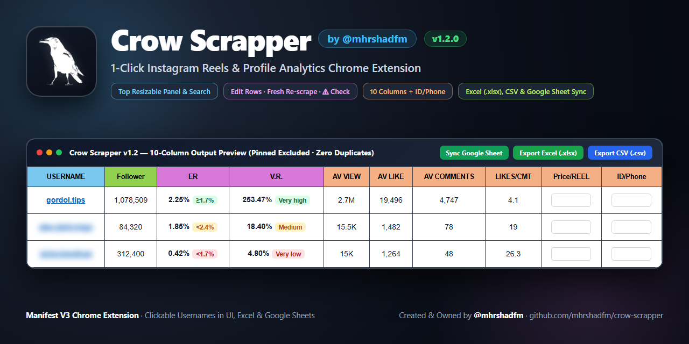

<div align="center">


# Crow Scrapper

**Instagram Reels & Profile Engagement Analytics Chrome Extension**  
Created & Owned by **[@mhrshadfm](https://www.instagram.com/mhrshadfm/)**

[](#installation)
[](https://www.instagram.com/mhrshadfm/)
[](#shared-google-sheet-live-sync)
[](LICENSE)

<br />



</div>

---

## Overview

**Crow Scrapper** (by **[@mhrshadfm](https://www.instagram.com/mhrshadfm/)**) is a lightweight, zero-dependency **Manifest V3 Chrome Extension** built for influencer marketing, creator vetting, and social media analytics on Instagram.

When you open any Instagram profile (`https://www.instagram.com/<username>/`), **Crow Scrapper** injects a **Scrape Profile** button with the white crow emblem directly next to the creator's username. With one click, it analyzes their **6 most recent non-pinned Reels** (automatically skipping pinned posts so old viral pins never skew your numbers), calculates **Engagement Rate (`ER`)**, **View Rate (`V.R.`)**, **Average Views (`AV VIEW` in `K`/`M`)**, **Average Likes**, **Average Comments**, and **Likes Per Comment**, and exports your list to **Excel (`.xlsx`)**, **CSV (`.csv`)**, or a **Shared Google Sheet** with clickable profile links and strict duplicate prevention.

---

## Key Features

- **In-Header 1-Click Scrape Button** — Appears right next to the username on any Instagram profile page (`https://www.instagram.com/<username>/`).
- **Compact Top Panel (v1.2)** — The in-page list lives behind a small **crow icon at the top of the screen** (drag it anywhere — the position is remembered). Click it to open the list right under the icon; minimize (or press `Esc`) and it shrinks back to just the icon. **Resize the list window** by dragging its edge or corner grip (double-click an edge to reset); the size is remembered. Includes search, sorting and a count badge that turns orange when a row needs a check.
- **Fix Wrong Scrapes (v1.2)** — Every row has **✎ Edit** (correct followers, averages, or each of the 6 reels used — ER / V.R. recalculate live) and **↻ Re-scrape fresh** (reloads the profile and scrapes it again with no cached data). Rows that look mis-scraped (likes above views, views equal to comments, absurd V.R., too few reels, page-tile fallback) are marked **⚠ check**.
- **ID / Phone Column (v1.2)** — Store each creator's contact (ID, phone or email) next to **Price/REEL**; it is exported to Excel, CSV and your Google Sheet, and phone numbers stay as text (`+98…` is never turned into a formula).
- **6 Recent Non-Pinned Reels Only** — Automatically detects and excludes up to 3 pinned posts/Reels (via API metadata, DOM pin badges, and timestamp-inversion detection) so old pinned posts never distort current performance. Includes an optional **"Skip most recent post/reel"** toggle to exclude newly published posts that haven't matured yet.
- **Written `K` / `M` Reel View Scraping** — Scrapes the written view count (`1.5M`, `450K`, `85K`) directly from the profile's Reels, counting `M` as Millions (`× 1,000,000`) and `K` as Thousands (`× 1,000`), and enters `AV VIEW` in clean `K` / `M` notation.
- **View Rate (`V.R.`) & 5 Performance Bands** — Calculates `V.R. = (AV VIEW / Follower) × 100%` and classifies each profile into **Very low**, **Low**, **Medium**, **High**, or **Very high**.
- **Engagement Rate (`E.R.`) & Follower Tier Benchmarks** — Calculates `ER = ((AV LIKE + AV COMMENTS) / Follower) × 100%` and compares it against industry follower-tier benchmarks (`≤1K` to `≥100K`).
- **Clickable Usernames Everywhere** — Every username in the extension popup, in-page floating panel, exported **Excel (`.xlsx`)**, and **Shared Google Sheet** is a clickable hyperlink that opens `https://www.instagram.com/<username>/`.
- **Native Styled Excel (`.xlsx`) & UTF-8 CSV (`.csv`) Export** — Generates color-coded OpenXML `.xlsx` spreadsheets and `.csv` files locally with zero external dependencies.
- **Shared Google Sheet Sync with Strict Deduplication** — Connects to any Shared Google Sheet via a **1-Click Copy Google Apps Script** (no Google Cloud OAuth setup required) or **Google Sheets REST API v4**. Existing usernames are updated in place (a `Price/REEL` value typed in the sheet always wins over the extension's copy) and are **never added twice**.

---

## 10-Column Output Layout

Every scraped profile is stored and exported using the following 10-column structure:

| # | Column Name | Header Color | Format / Formula | Description |
| :-: | :--- | :--- | :--- | :--- |
| **1** | **`USERNAME`** | Sky Blue (`#78C8F0`) | Clickable Hyperlink | Creator's handle linked to `https://www.instagram.com/<username>/` |
| **2** | **`Follower`** | Green (`#92D050`) | `#,##0` | Total follower count (e.g., `373,760`) |
| **3** | **`ER`** | Purple (`#D878D8`) | `0.00%` + Benchmark Badge | `((AV LIKE + AV COMMENTS) / Follower) × 100%` |
| **4** | **`V.R.`** | Purple (`#D878D8`) | `0.00%` + Band Badge | `(AV VIEW / Follower) × 100%` |
| **5** | **`AV VIEW`** | Orange (`#F4B084`) | Written `K` / `M` | Average Reel views across 6 recent non-pinned Reels (e.g., `1.5M`, `120K`) |
| **6** | **`AV LIKE`** | Orange (`#F4B084`) | `#,##0` | Average likes across 6 recent non-pinned Reels |
| **7** | **`AV COMMENTS`** | Orange (`#F4B084`) | `#,##0` | Average comments across 6 recent non-pinned Reels |
| **8** | **`LIKES PER COMMENT`** | Orange (`#F4B084`) | `0.0` | `AV LIKE / AV COMMENTS` rounded to 1 decimal place |
| **9** | **`Price/REEL`** | Orange (`#F4B084`) | Editable / Empty (`""`) | Kept empty by default for your pricing notes |
| **10** | **`ID/Phone`** | Orange (`#F4B084`) | Editable text / Empty (`""`) | Creator's contact — ID, phone number or email (stored as text) |

---

## Benchmarks & View Rate Bands

### 1. View Rate (`V.R.`) Bands
> **Formula:** `V.R. = Average Plays of Last 6 Non-Pinned Reels ÷ Total Followers`

| V.R. Band | View Rate Range | Meaning |
| :--- | :--- | :--- |
| **Very low** | `≤ 10%` | Views are significantly below follower count |
| **Low** | `10% – 15%` | Below-average Reel reach |
| **Medium** | `15% – 30%` | Healthy, standard Reel reach |
| **High** | `30% – 50%` | Strong viral/algorithmic reach |
| **Very high** | `≥ 50%` | Exceptional reach relative to audience size |

### 2. Engagement Rate (`E.R.`) Benchmarks by Follower Tier
> **Formula:** `E.R. = (Average Likes + Average Comments of Last 6 Non-Pinned Reels) ÷ Total Followers`

| Follower Tier | Target E.R. Benchmark |
| :--- | :--- |
| **`≤ 1,000` followers** | **`8.0%`** |
| **`1,000 – 5,000` followers** | **`5.7%`** |
| **`5,000 – 10,000` followers** | **`4.0%`** |
| **`10,000 – 100,000` followers** | **`2.4%`** |
| **`≥ 100,000` followers** | **`1.7%`** |

---

## Installation

1. **Download the Release ZIP or Clone this Repository:**
   - **Option A (Easiest):** Download **`Crow-Scrapper-v1.2.0.zip`** from the [Releases](https://github.com/mhrshadfm/crow-scrapper/releases) section and extract the folder.
   - **Option B (Git Clone):**
     ```bash
     git clone https://github.com/mhrshadfm/crow-scrapper.git
     ```
2. Open Google Chrome and navigate to:
   ```text
   chrome://extensions
   ```
3. Turn on **Developer mode** using the toggle in the top-right corner.
4. Click **Load unpacked** in the top-left corner and select the `crow-scrapper` folder (the folder containing `manifest.json`).
5. Open any profile on [Instagram](https://www.instagram.com/) and click the **`Scrape Profile`** button next to their username!

---

## Shared Google Sheet Live Sync

**Crow Scrapper** can sync your scraped list directly into a **Shared Google Sheet** while guaranteeing **zero duplicate rows**:

1. Click the **Crow Scrapper** icon in your Chrome toolbar (or open the crow icon at the top of Instagram) and expand **☁️ Shared Google Sheet Connection & Auto-Deduplication**.
2. Paste your **Shared Google Sheet URL** (`https://docs.google.com/spreadsheets/d/.../edit`).
3. Click **📋 Copy Google Sheet Script**.
4. In your Google Sheet, open **Extensions → Apps Script**, replace any code in `Code.gs` with the copied script, and click **Save**.
5. Click **Deploy → New deployment**:
   - **Select type:** `Web app`
   - **Execute as:** `Me`
   - **Who has access:** `Anyone`
6. Click **Deploy**, copy the generated **Web App URL** (`https://script.google.com/macros/s/.../exec`), and paste it into **Apps Script Web App URL** in **Crow Scrapper**.
7. Click **💾 Save & Sync Sheet** (and optionally enable **Auto-add/update in Google Sheet on Scrape**).

> **Updating from v1.0.0?** Click **📋 Copy Google Sheet Script** again, paste it over the old code, and redeploy (**Deploy → Manage deployments → Edit → New version**). The v1.1.0 script only accepts requests that carry your extension's private sync token and always writes to *your* sheet, so knowing the Web App URL alone is no longer enough to modify it.

> **Updating to v1.2.0?** Copy the script and redeploy once more so the sheet gets the new **ID/Phone** column (J).

> **Smart Deduplication:** Whenever you sync or re-scrape a profile that already exists in your Google Sheet, Crow Scrapper updates that creator's row in place and preserves any `Price/REEL` (Column I) and `ID/Phone` (Column J) value you already entered.

---

## Safe Usage Tips

- **Human-Initiated Only:** Crow Scrapper never crawls profiles in the background—it only runs when you manually click **Scrape Profile** on a profile you are viewing.
- **Recommended Pace:** Wait **5–10 seconds** between scraping different profiles and keep daily volume under **~30–40 profiles/hour** (`~150–200 profiles/day`) to avoid temporary Instagram rate limits.

---

## Project Structure

```text
├── icons/
│   ├── crow-white.png       # White crow emblem (256x256 transparent PNG)
│   ├── icon16.png           # Toolbar icon (16x16)
│   ├── icon48.png           # Extension management icon (48x48)
│   └── icon128.png          # Chrome Web Store / High-DPI icon (128x128)
├── src/
│   ├── core.js              # Metrics engine, K/M parser, OpenXML .xlsx generator, Google Sheets sync planner
│   ├── content.js           # Instagram profile button, Reels scraper, & top launcher + in-page list panel
│   ├── content.css          # Styles for the in-header button, launcher icon & panel
│   ├── editor.js            # Shared "Edit profile" dialog (panel + popup): fix numbers, per-reel edits
│   ├── editor.css           # Styles for the edit dialog & shared metric badges
│   ├── popup.html           # Extension toolbar popup UI
│   ├── popup.js             # Popup controller, exports, & Google Sheet settings
│   ├── popup.css            # Styles for the extension popup
│   └── background.js        # Manifest V3 service worker (badge counter & Google Sheet sync relay)
├── tests/
│   ├── scraper.test.js      # Unit & Apps Script VM test suite
│   ├── xlsx-and-dom.test.js # OpenXML .xlsx ZIP/CRC32/XML schema & hyperlink verifier
│   ├── browser-e2e.test.js  # Headless Chrome E2E tests for content script & popup UI
│   ├── panel-ui-e2e.test.js # Headless Chrome test for the top panel, ID/Phone & edit dialog
│   ├── tile-reading-e2e.test.js # Headless Chrome test for reading reel tiles when the API is unavailable
│   ├── v1.1-regressions.test.js
│   └── v1.2-features.test.js
├── manifest.json            # Chrome Extension Manifest V3 configuration
├── LICENSE                  # MIT License
└── README.md                # Documentation
```

---

## Running Tests

```bash
node tests/scraper.test.js
node tests/xlsx-and-dom.test.js
node tests/browser-e2e.test.js
node tests/v1.1-regressions.test.js
node tests/v1.2-features.test.js
node tests/panel-ui-e2e.test.js
node tests/tile-reading-e2e.test.js
```

---

## Author & License

- **Creator & Owner:** **[@mhrshadfm](https://www.instagram.com/mhrshadfm/)**
- **License:** Distributed under the [MIT License](LICENSE). Attribution to **@mhrshadfm** must be retained in all copies or substantial portions of the software.
